# BSK – All-in-One Clinic Management System

BSK is a desktop clinic management system for small Vietnamese clinics, built in Java Swing with a client–server setup. One machine runs the **server** (SQLite database + dashboard). The reception desk, the doctor's room and the waiting-room TV each run a **client** and connect over the clinic's LAN.

It covers the whole visit: registering the patient, the waiting queue, the TV call-out screen, the exam and ultrasound report, prescriptions and services, printing and invoicing, follow-up reminders, and an Excel export at the end of the day.

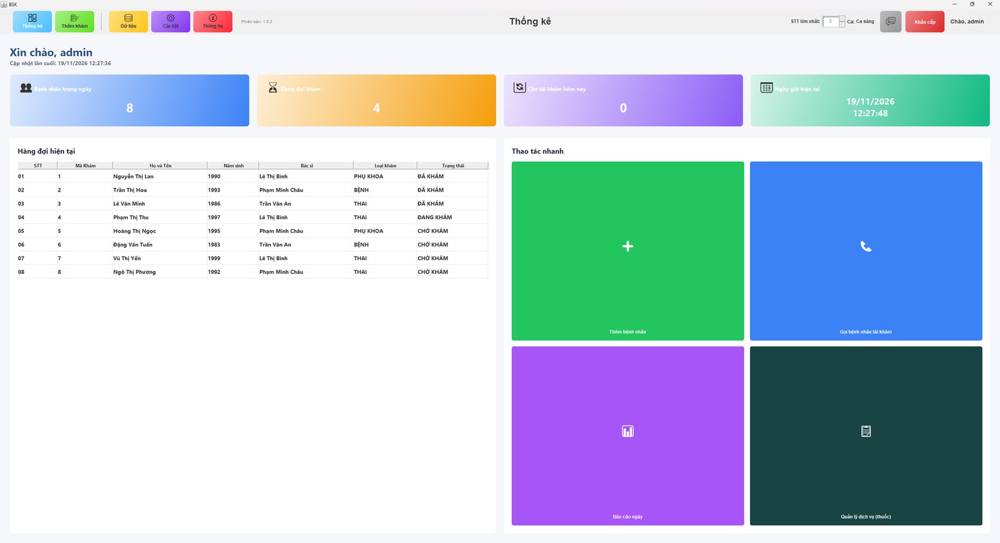

> The UI is in Vietnamese. All screenshots in this README come from a demo database with made-up patients, doctors and clinic details.

<p align="center">
  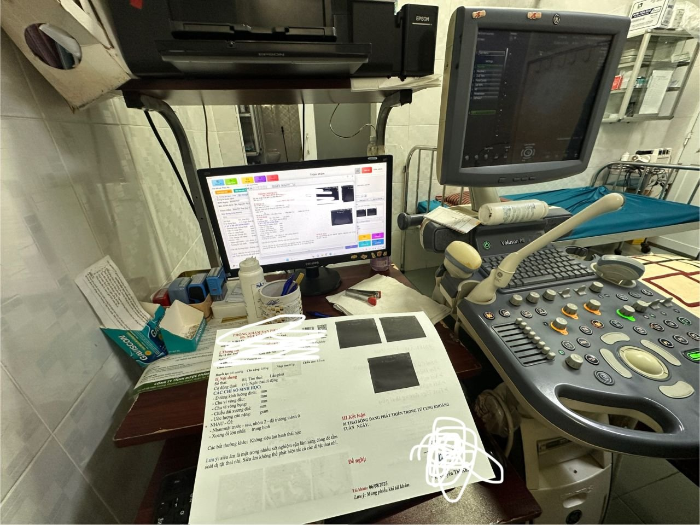
  <br><em>BSK in daily use at a clinic: the check-up screen next to the ultrasound machine, and a printed report.</em>
</p>

---

## Features

**Front desk**
- Register new patients or look up returning ones by name, phone or patient ID. Province and ward come from the built-in Vietnamese administrative-unit tables.
- Each patient gets a queue number per shift (*Ca sáng* / *Ca chiều*), and the queue updates live on every connected client.
- A **TV waiting-room screen** (*Màn hình chờ TV*) shows the queue and the status of each exam room (*Phòng 1 / Phòng 2*).

**Exam room**
- One check-up screen holds patient info, vitals (weight, height, heart rate, blood pressure) and the visit history.
- Rich-text exam notes with **report templates** (*mẫu*): general, gynecology, pregnancy trimesters, NT, 4D, thyroid, breast, and more. You can add your own templates from the app.
- **Imaging:** take photos or record video from a webcam or capture card (JavaCV/OpenCV/FFmpeg). The app also scans the ultrasound machine's export folder (`ANH SIEU AM`) and picks up new images automatically.
- Prescriptions (*Đơn thuốc*) with morning/noon/evening dosing, plus billable services (*Dịch vụ*). Totals are calculated as you go.
- *Gọi bệnh nhân* calls a patient into a room and updates the TV screen.
- Follow-up dates (*Tái khám*), with a recheck list on the dashboard.

**Printing**
- JasperReports templates for the **ultrasound result** (landscape or portrait) and the **medicine/service invoice** (A4 or A5).
- Each printout carries a Code-128 barcode of the visit ID and a QR code that links to the patient's Google Drive folder.

**Admin & data**
- Manage visits, medicines, services, users and doctors (*Quản Lý Dữ Liệu*), with filtering and **Excel export** (Apache POI).
- Settings dialog for clinic name, address, phone, server address and storage paths.
- An emergency button (*Khẩn cấp*) that alerts every client, and a simple chat between stations.

**Server**
- A live dashboard: connected clients, RAM/CPU, DB size and logs.
- Optional **Google Drive** integration: each patient gets a folder for their images and PDFs, and the server can back up the database to Drive in one click.
- SQLite in WAL mode with `synchronous=EXTRA` and a periodic checkpoint, so a power cut at the clinic doesn't lose data.
- Passwords are stored as salted PBKDF2-HMAC-SHA256 hashes. Any old plain-text passwords are converted automatically the first time the server starts.

## Screenshots

| | |
|---|---|
| 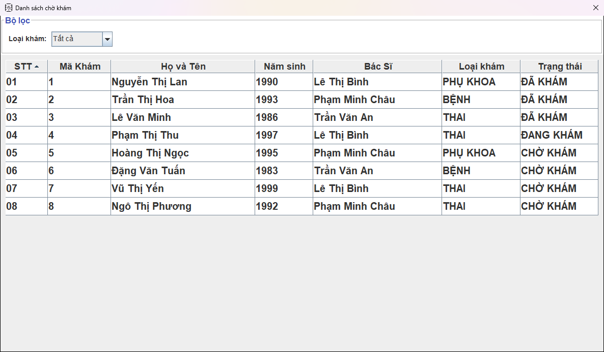 <br>**Waiting list** (*Danh sách chờ khám*) | 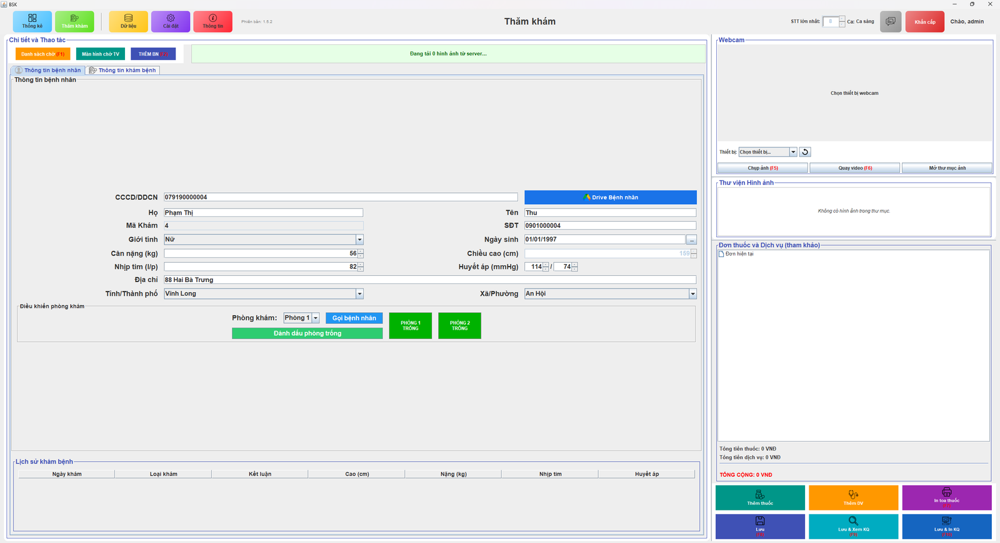 <br>**Check-up: patient information** |
| 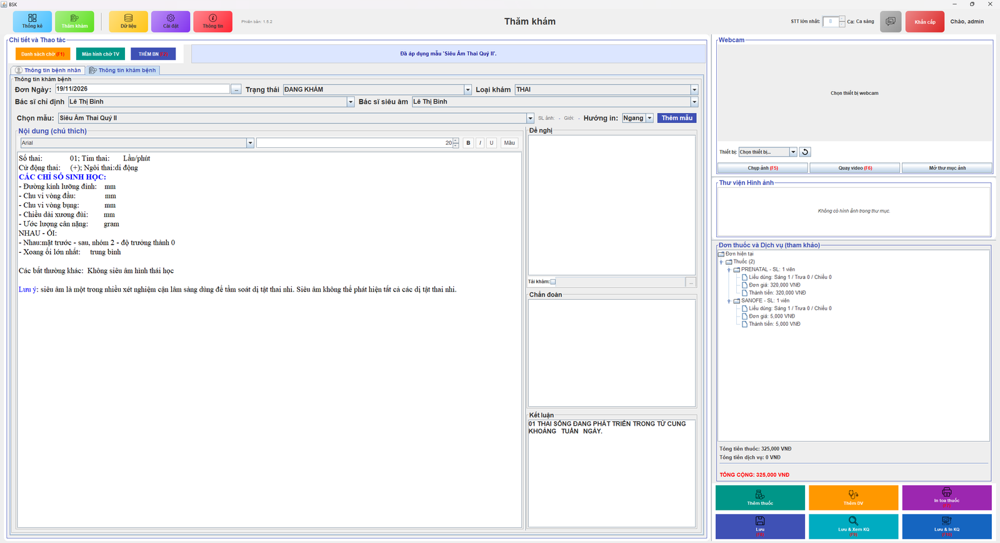 <br>**Check-up: exam with a template and a prescription** | 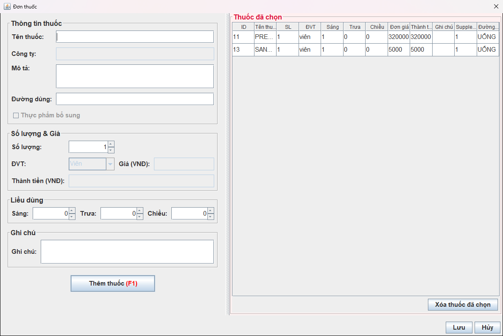 <br>**Prescription dialog** with search-as-you-type |
| 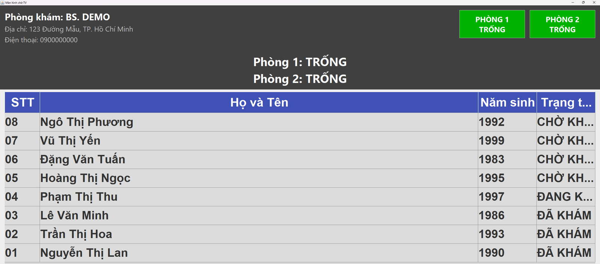 <br>**Waiting-room TV screen** | 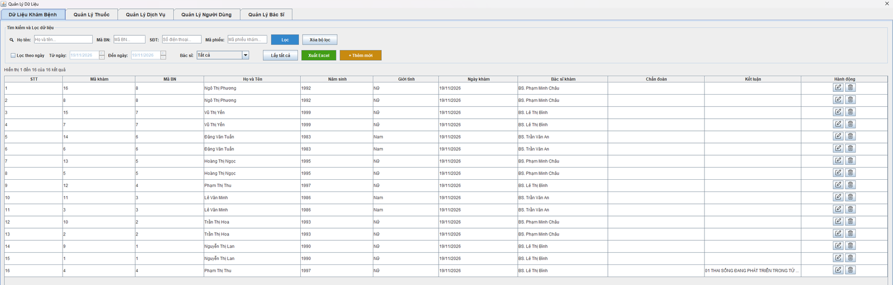 <br>**Data management** with filters and Excel export |
| 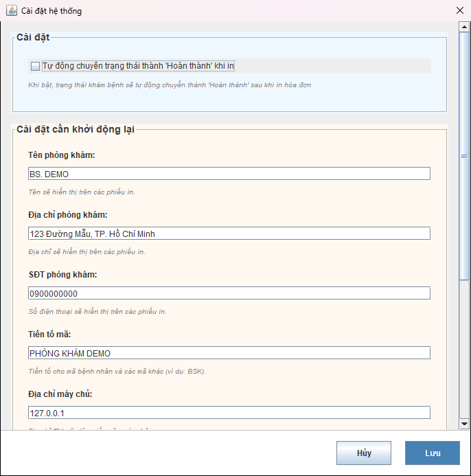 <br>**Settings** | 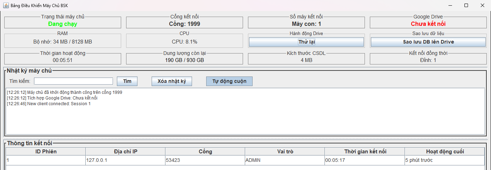 <br>**Server dashboard** |

## Architecture

```
 ┌──────────────┐   ┌──────────────┐   ┌──────────────┐
 │ Client       │   │ Client       │   │ Client       │   Java Swing desktop apps
 │ (reception)  │   │ (exam room)  │   │ (TV screen)  │   BsK.client.Client
 └──────┬───────┘   └──────┬───────┘   └──────┬───────┘
        │   WebSocket ws://<server>:1999/ (JSON packets)
        └──────────────────┼──────────────────┘
                    ┌──────┴───────┐
                    │ Server       │  Netty + dashboard UI     BsK.server.Server
                    │              │  HikariCP → SQLite (WAL)  database/BSK.db
                    └──────┬───────┘
                           │ optional
                    ┌──────┴───────┐
                    │ Google Drive │  patient folders, DB backups
                    └──────────────┘
```

- **Protocol:** every message is a `Packet` subclass (`common/packet/req`, `common/packet/res`), serialized by Gson with the class name as a type tag (`PacketSerializer`). The server dispatches packets in `server/network/handler/ServerHandler.java`; the client routes responses to listeners via `ClientHandler` / `ResponseListener`.
- **Real-time updates:** queue changes, room calls, emergencies and chat messages are broadcast to every connected session.

### Tech stack

| Area | Library |
|---|---|
| Language / build | Java 21, Maven, Lombok |
| Networking | Netty 4 (WebSocket) |
| Database | SQLite (`sqlite-jdbc`) + HikariCP |
| UI | Swing, SwingX, JDatePicker |
| Imaging | webcam-capture, JavaCV (OpenCV + FFmpeg) |
| Reports | JasperReports 7, Barcode4J, ZXing (QR) |
| Export | Apache POI (Excel) |
| Cloud | Google Drive API v3 (OAuth 2.0) |
| Logging | SLF4J + Log4j2 |

## Getting started

### Requirements

- **JDK 21** and **Maven 3.9+**
- Windows is the main target (the clinic machines run Windows), but the code is plain Java.
- A BSK SQLite database at `database/BSK.db`. The server opens this file directly and **does not create the schema**, so you need an existing BSK database. The database is git-ignored because it holds patient data.

### 1. Build

```bash
mvn compile
```

`mvn package` also builds two runnable fat JARs in `target/`: `bsk-server-jar-with-dependencies.jar` and `bsk-client-jar-with-dependencies.jar`. They are large (~650 MB) because JavaCV bundles native OpenCV/FFmpeg for every platform.

### 2. Configure

Copy `config/config.properties.example` to `config/config.properties` and fill in your clinic's details. The real file is git-ignored so clinic details never get committed. The server and the client both read it from the working directory:

| Key | Meaning | Example |
|---|---|---|
| `server.address` | Server IP that clients connect to | `127.0.0.1` or `192.168.1.10` |
| `server.port` | WebSocket port | `1999` |
| `clinic.name` / `clinic.prefix` | Printed on reports and the TV screen | `BS. ...` / `PHÒNG KHÁM ...` |
| `clinic.address`, `clinic.phone` | Printed on reports | |
| `google.drive.enabled` | Turn the Drive integration on or off | `false` for local testing |
| `google.drive.root.folder` | Root folder name on Drive | `BSK_Clinic_Patient_Files` |
| `storage.checkup_media_base_dir` | Where photos and videos are stored | `image/checkup_media` |
| `storage.ultrasound_folder_path` | Folder the ultrasound machine exports to | `ANH SIEU AM` |
| `app.auto_change_status_to_finished` | Mark the visit as done after printing | `false` |

Most of these can also be changed from the client's **Cài đặt** (Settings) dialog.

### 3. Run: server first, then client

Run both from the **repository root**. Paths such as `database/`, `config/` and the UI icons under `src/main/java/BsK/client/ui/assets/` are resolved relative to the working directory.

From an IDE, use the included run configurations **BSK Server** and **BSK Client** (IntelliJ: `.idea/runConfigurations`, VS Code: `.vscode/launch.json`).

From a terminal (PowerShell):

```powershell
mvn -q dependency:build-classpath "-Dmdep.outputFile=cp.txt"
$cp = "target/classes;" + (Get-Content cp.txt)

java -cp $cp BsK.server.Server     # 1. starts the server dashboard on port 1999
java -cp $cp BsK.client.Client     # 2. in a second terminal (or on another PC)
```

Or with the packaged JARs:

```bash
java -jar server.jar
java -jar client.jar
```

### 4. First login

When the server starts, it checks the `User` table:

- Any plain-text passwords are converted to PBKDF2 hashes.
- If there is **no active admin**, it creates (or restores) the `admin` account with a random 16-character password. The password is shown **once** in a dialog on the server. Write it down before you close the dialog.

Then, on the client, click **Đăng nhập**, enter the username and password, choose a shift (**Ca sáng** or **Ca chiều**) and log in. You can add more users and doctors under **Dữ liệu → Quản Lý Người Dùng / Quản Lý Bác Sĩ**.

## Google Drive integration (optional)

1. Create an OAuth 2.0 *Desktop app* client in Google Cloud Console with the Drive API enabled.
2. Save the downloaded client secret as `google-oauth-credentials.json` in the working directory.
3. Set `google.drive.enabled=true`. On the first start, a browser window opens for consent and the token is cached in `tokens/`.

If Drive is unavailable, the server still starts and runs without it. The dashboard shows the Drive status, with buttons to retry the connection or back up the database. `google-oauth-credentials.json` and `tokens/` are git-ignored, so never commit them.

## Print templates

The report layouts live in `src/main/resources/print_forms/`:

| File | Used for |
|---|---|
| `ultrasoundresult.jrxml` / `ultrasoundresult_potrait.jrxml` | Ultrasound result (landscape / portrait) |
| `medserinvoice.jrxml` / `medserinvoice_A5.jrxml` | Medicine + service invoice (A4 / A5) |

You can edit them with **Jaspersoft Studio**. The fonts (SVN-Arial, Times New Roman, Arial Narrow) are bundled as JasperReports font extensions so Vietnamese text renders correctly in PDFs.

<p align="center">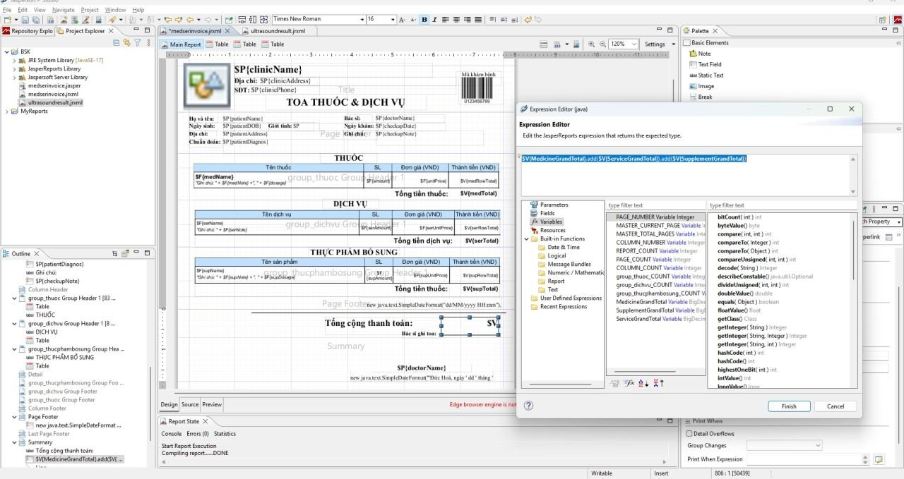</p>

## Encryption between clients and the server

Traffic between the clients and the server is encrypted with TLS (`wss://`) on the same port as before.

- **Server:** on first start it creates its own key and self-signed certificate in `config/tls/server.p12` (git-ignored) and reuses it afterwards. The dashboard shows the certificate's SHA-256 fingerprint.
- **Clients:** on the first encrypted connection a client saves the server's fingerprint as `client.tls.server_fingerprint` in `config/config.properties`, and from then on refuses any other certificate. IP addresses and host names are not part of the check, so the server's address can change without a new certificate.

Settings (see `config/config.properties.example`):

| Key | Where | Default | Meaning |
|---|---|---|---|
| `server.tls.enabled` | server | `true` | Turn TLS on or off on the server. |
| `server.tls.allow_plaintext` | server | `true` | Also accept clients that are not updated yet, on the same port. |
| `client.tls.enabled` | client | `true` | Connect with TLS. Set `false` to roll a client back. |
| `client.tls.server_fingerprint` | client | (filled in automatically) | The trusted server certificate. |

**Rolling it out:**
1. Update the server. Old clients keep working, and the dashboard lists each one that connects without encryption.
2. Update each client. Each one connects with TLS and saves the fingerprint. Optionally compare it with the fingerprint on the server dashboard.
3. On the server, set `server.tls.allow_plaintext=false` and restart.

**If the server is reinstalled or replaced** (so `config/tls/server.p12` is new), clients show a "certificate does not match" error. After checking that the change is expected, delete the `client.tls.server_fingerprint` line on each client and start it again.

TLS protects data on the network only. It does not encrypt the database or images on the server's disk.

## Deployment and updates

A typical clinic install keeps `server.jar` / `client.jar` next to `config/`, `database/` and the version files. The `update_server.bat` / `update_client.bat` scripts (PowerShell under the hood) work like this:

1. Read the local `version_server.json` / `version_client.json`.
2. Fetch `latest.json` from the GitHub release.
3. If there is a newer version, stop the app, back up the old JAR as `*.jar.old`, download the new JAR and restart.

## Project layout

```
src/main/java/BsK/
├── server/                 Server entry point, dashboard, Netty handler, DB pool,
│   ├── security/           password hashing + account bootstrap
│   └── service/            Google Drive (OAuth) service
├── client/                 Client entry point, LocalStorage (session/config state)
│   ├── network/            WebSocket client, connection manager, response routing
│   └── ui/component/       Swing pages: Landing, Login, Dashboard, CheckUp, QueueView,
│                           DataDialog (management + Excel), Settings, print dialogs
└── common/                 Shared entities, request/response packets, utilities
src/main/resources/         Fonts, icons, JasperReports templates, log4j2 config
config/config.properties    Runtime configuration
```

## Authors

Made by **lds217** and **miti99**.
